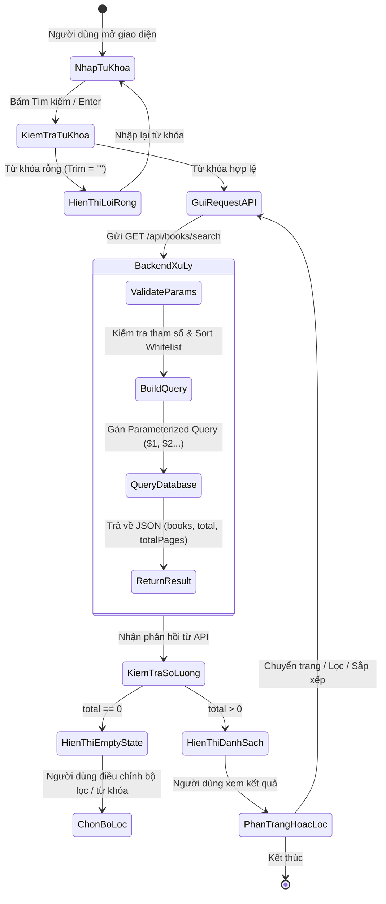
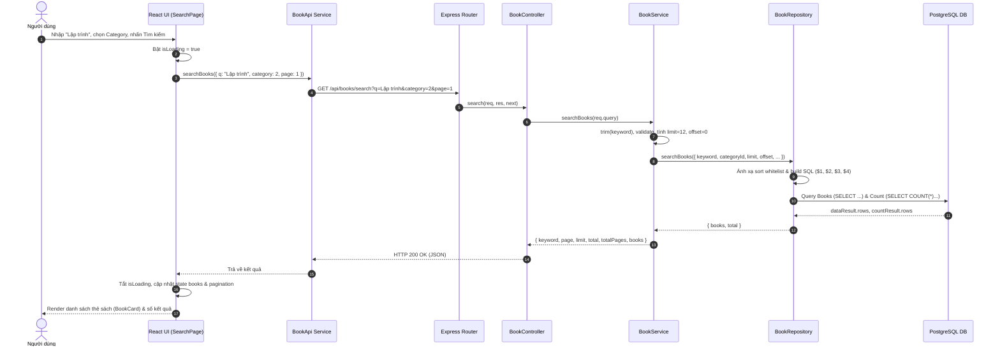
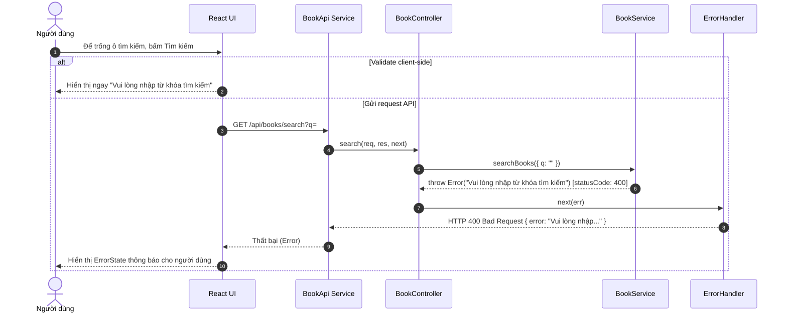
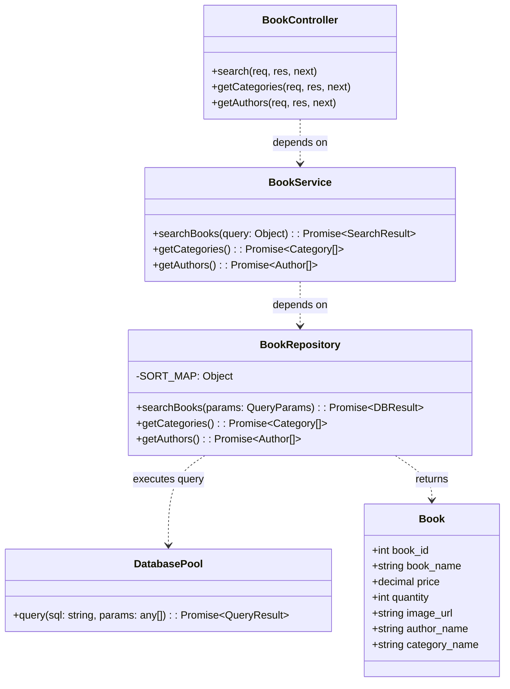
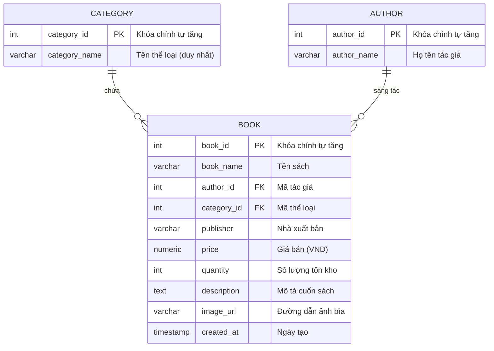

# BÁO CÁO ĐỒ ÁN MÔN CÔNG NGHỆ PHẦN MỀM

## ĐỀ TÀI: MODULE TÌM KIẾM SÁCH TRONG HỆ THỐNG CỬA HÀNG BÁN SÁCH TRỰC TUYẾN
### MÃ NHÓM & ĐỀ TÀI: 02_BS5_SearchBook
**Lớp học phần:** 24cntt1-2627 | **Giảng viên hướng dẫn:** ThS. Vũ Thị Trà  
**Tên file nộp bài chuẩn quy ước:** `02_BS5_SearchBook_requirement & design.docx`

---

### DANH SÁCH THÀNH VIÊN NHÓM 02 & TỶ LỆ ĐÓNG GÓP

| STT | Họ và tên | MSSV | Vai trò | Nhiệm vụ phụ trách chính | % Đóng góp |
| :---: | :--- | :---: | :--- | :--- | :---: |
| **1** | **Đinh Trịnh Ngọc Hưng** | 102210001 | Trưởng nhóm / Backend Lead | Quản lý chung dự án, kiến trúc phân tầng Backend (Repo - Service - Controller - Route), thuật toán tìm kiếm, chống SQL Injection. | **100%** |
| **2** | **Nguyễn Thị Kiều Trang** | 102210002 | Database Designer / Dev | Phân tích CSDL 3NF, cấu hình extension unaccent, viết DB scripts & seed data (40 sách, 25 tác giả, 7 thể loại). | **100%** |
| **3** | **Lê Minh Quân** | 102210003 | Frontend Lead Developer | Cấu trúc ứng dụng React 18, thiết kế giao diện UI, component SearchBar, BookList, BookCard, Pagination. | **100%** |
| **4** | **Nguyễn Phạm Tiến Dũng** | 102210004 | Frontend & API Integration | Component FilterBar (lọc thể loại, tác giả, giá, sắp xếp), kết nối API Express (bookApi.js), tối ưu UX. | **100%** |
| **5** | **Nguyễn Trần Thu Thắm** | 102210005 | Business Analyst & QA | Đặc tả User Stories & Acceptance Criteria Gherkin, thiết kế bộ 66 Test Cases, thực thi kiểm thử và biên soạn tài liệu. | **100%** |

---

## MỤC LỤC

1. [Tổng Quan Đề Tài & Phạm Vi Nghiên Cứu](#1-tổng-quan-đề-tài--phạm-vi-nghiên-cứu)
2. [Kiến Trúc & Công Nghệ Sử Dụng](#2-kiến-trúc--công-nghệ-sử-dụng)
3. [Mô Hình Ca Sử Dụng (Use Case Diagram & Specification)](#3-mô-hình-ca-sử-dụng-use-case-diagram--specification)
4. [Biểu Đồ Hoạt Động (Activity Diagram)](#4-biểu-đồ-hoạt-động-activity-diagram)
5. [Biểu Đồ Tuần Tự (Sequence Diagram)](#5-biểu-đồ-tuần-tự-sequence-diagram)
6. [Biểu Đồ Lớp (Class Diagram)](#6-biểu-đồ-lớp-class-diagram)
7. [Thiết Kế Cơ Sở Dữ Liệu (ERD & Data Dictionary)](#7-thiết-kế-cơ-sở-dữ-liệu-erd--data-dictionary)
8. [Tài Liệu Đặc Tả API (API Documentation)](#8-tài-liệu-đặc-tả-api-api-documentation)
9. [Bộ Kịch Bản Kiểm Thử (Test Cases)](#9-bộ-kịch-bản-kiểm-thử-test-cases)
10. [Báo Cáo Kết Quả Kiểm Thử (Test Report)](#10-báo-cáo-kết-quả-kiểm-thử-test-report)
11. [Kịch Bản Demo Nghiệm Thu (Demo Script)](#11-kịch-bản-demo-nghiệm-thu-demo-script)

---

## 1. TỔNG QUAN ĐỀ TÀI & PHẠM VI NGHIÊN CỨU

### 1.1. Đặt vấn đề

Trong các hệ thống thương mại điện tử chuyên ngành sách (Bookstore E-commerce), việc định vị và tìm kiếm sản phẩm nhanh chóng, chính xác là yếu tố sống còn quyết định trải nghiệm người dùng. Module tìm kiếm sách được thiết kế độc lập, tập trung giải quyết triệt để nhu cầu tra cứu sách với tốc độ cao, độ chính xác cao và an toàn bảo mật.

### 1.2. Phạm vi module (Scope)

- **Nằm trong phạm vi (In-Scope)**:
  - Nhập từ khóa tìm kiếm (tên sách, tác giả, thể loại).
  - Tìm kiếm gần đúng không phân biệt hoa thường (`ILIKE`).
  - Lọc kết quả đa tiêu chí: Thể loại (Category), Tác giả (Author), Khoảng giá (minPrice, maxPrice).
  - Sắp xếp kết quả linh hoạt: Theo giá (tăng/giảm dần), theo bảng chữ cái (A-Z, Z-A).
  - Phân trang dữ liệu (Pagination) tối ưu tải mạng và hiệu năng cơ sở dữ liệu.
  - Xử lý các trạng thái đặc biệt: Từ khóa rỗng, không có kết quả, loading, lỗi hệ thống, xóa nhanh từ khóa.
  - Bảo mật ứng dụng: Ngăn chặn tuyệt đối lỗ hổng SQL Injection bằng Parameterized Queries và Sort Whitelist.
- **Ngoại phạm vi (Out-of-Scope)**:
  - Đăng nhập/đăng ký tài khoản, phân quyền quản trị viên.
  - Quản lý giỏ hàng, đặt hàng, xử lý thanh toán.
  - Quản trị thêm/sửa/xóa sách, đánh giá bình luận, hệ thống gợi ý AI (Recommendation).

---

## 2. KIẾN TRÚC & CÔNG NGHỆ SỬ DỤNG

### 2.1. Ngăn xếp công nghệ (Technology Stack)

- **Frontend**: React 18, Vite, Vanilla CSS hiện đại (Design System, CSS Variables, Responsive Grid).
- **Backend**: Node.js, Express Framework (v5).
- **Database**: PostgreSQL (Relational Database Management System).
- **Giao thức**: HTTP RESTful API, JSON data exchange.

### 2.2. Kiến trúc phân tầng Backend (Layered Architecture)

Hệ thống tuân thủ nghiêm ngặt nguyên lý Single Responsibility Principle (SRP) và mô hình 4 tầng chuẩn công nghiệp:

1. **Route Layer (`routes/`)**: Định nghĩa endpoints, ánh xạ URL path và HTTP methods tới controller tương ứng.
2. **Controller Layer (`controllers/`)**: Tiếp nhận request, trích xuất query parameters, điều phối Service và trả về HTTP response (status code, JSON body).
3. **Service Layer (`services/`)**: Chứa Business Logic (nghiệp vụ hệ thống), validate dữ liệu đầu vào, chuẩn hóa chuỗi, tính toán số trang, limit/offset.
4. **Repository Layer (`repositories/`)**: Trực tiếp tương tác với cơ sở dữ liệu PostgreSQL qua connection pool, khởi dựng câu lệnh SQL tham số hóa (`$1, $2,...`), ánh xạ kết quả trả về.

```
[ Client / React Frontend ]
           │  HTTP Request (GET /api/books/search?q=...)
           ▼
[ Express Router (book.routes.js) ]
           │
           ▼
[ Controller (book.controller.js) ]
           │
           ▼
[ Service (book.service.js) ] ── (Validate, Calculate Pagination)
           │
           ▼
[ Repository (book.repository.js) ] ── (SQL Builder & Whitelist)
           │
           ▼
[ PostgreSQL Database (TIM_KIEM_SACH) ]
```

---

## 3. MÔ HÌNH CA SỬ DỤNG (USE CASE DIAGRAM & SPECIFICATION)

### 3.1. Sơ đồ Use Case (Mermaid)

```mermaid
flowchart LR
    Actor[Người dùng / Khách ghé thăm]

    subgraph Module Tìm Kiếm Sách
        UC1([Tìm kiếm sách theo từ khóa])
        UC2([Lọc sách theo thể loại])
        UC3([Lọc sách theo tác giả])
        UC4([Lọc sách theo khoảng giá])
        UC5([Sắp xếp danh sách kết quả])
        UC6([Chuyển trang kết quả])
        UC7([Xóa từ khóa tìm kiếm])
    end

    Actor --> UC1
    Actor --> UC2
    Actor --> UC3
    Actor --> UC4
    Actor --> UC5
    Actor --> UC6
    Actor --> UC7

    UC2 -.->|<<extend>>| UC1
    UC3 -.->|<<extend>>| UC1
    UC4 -.->|<<extend>>| UC1
    UC5 -.->|<<extend>>| UC1
    UC6 -.->|<<extend>>| UC1
```



### 3.2. Bảng đặc tả Use Case chi tiết (Use Case Specification)

| Thuộc tính                           | Chi tiết                                                                                                                                                                                                                                                                                                                                                                                             |
| :----------------------------------- | :--------------------------------------------------------------------------------------------------------------------------------------------------------------------------------------------------------------------------------------------------------------------------------------------------------------------------------------------------------------------------------------------------- |
| **Mã Use Case**                      | **UC-01**                                                                                                                                                                                                                                                                                                                                                                                            |
| **Tên Use Case**                     | Tìm kiếm sách (Search Books)                                                                                                                                                                                                                                                                                                                                                                         |
| **Tác nhân (Actor)**                 | Người dùng (Khách hàng)                                                                                                                                                                                                                                                                                                                                                                              |
| **Mục đích**                         | Cho phép người dùng tìm kiếm và lọc danh sách sách trong hệ thống theo nhiều tiêu chí.                                                                                                                                                                                                                                                                                                               |
| **Tiền điều kiện**                   | Hệ thống Web đang hoạt động, kết nối CSDL PostgreSQL ổn định.                                                                                                                                                                                                                                                                                                                                        |
| **Hậu điều kiện**                    | Danh sách sách phù hợp được hiển thị trực quan kèm thông tin phân trang.                                                                                                                                                                                                                                                                                                                             |
| **Luồng sự kiện chính (Basic Flow)** | 1. Người dùng nhập từ khóa vào ô tìm kiếm.<br>2. (Tùy chọn) Người dùng chọn thể loại, tác giả, nhập khoảng giá hoặc kiểu sắp xếp.<br>3. Người dùng nhấn nút "Tìm kiếm" hoặc nhấn phím Enter.<br>4. Hệ thống kiểm tra từ khóa hợp lệ.<br>5. Hệ thống truy vấn CSDL tìm kiếm gần đúng theo tên sách, tác giả, thể loại.<br>6. Hệ thống hiển thị danh sách sách thỏa mãn cùng tổng số kết quả tìm thấy. |
| **Luồng phụ (Alternative Flows)**    | **A1: Người dùng chuyển trang (Pagination)**<br>- Người dùng chọn số trang mong muốn.<br>- Hệ thống tải các bản ghi tiếp theo tương ứng với offset.<br>**A2: Người dùng xóa từ khóa**<br>- Người dùng bấm nút ✕ trên thanh tìm kiếm.<br>- Ô nhập liệu được xóa trống.                                                                                                                                |
| **Luồng ngoại lệ (Exception Flows)** | **E1: Từ khóa rỗng**<br>- Nếu người dùng không nhập hoặc chỉ nhập dấu cách trắng rồi tìm kiếm:<br>- Hệ thống hiển thị thông báo lỗi: _"Vui lòng nhập từ khóa tìm kiếm"_ (HTTP 400).<br>**E2: Không tìm thấy kết quả**<br>- Không có sách nào khớp với từ khóa và bộ lọc.<br>- Hệ thống hiển thị Empty State kèm gợi ý tìm kiếm thay thế.                                                             |

---

## 4. BIỂU ĐỒ HOẠT ĐỘNG (ACTIVITY DIAGRAM)



---

## 5. BIỂU ĐỒ TUẦN TỰ (SEQUENCE DIAGRAM)

### 5.1. Luồng tìm kiếm thành công (Success Flow)



### 5.2. Luồng xử lý từ khóa rỗng (Validation Exception Flow)



---

## 6. BIỂU ĐỒ LỚP (CLASS DIAGRAM)



---

## 7. THIẾT KẾ CƠ SỞ DỮ LIỆU (ERD & DATA DICTIONARY)

### 7.1. Sơ đồ thực thể kết hợp (ERD - Mermaid)



### 7.2. Từ điển dữ liệu (Data Dictionary)

#### Bảng `category` (Thể loại sách)

| Tên cột         | Kiểu dữ liệu | Ràng buộc        | Mô tả                               |
| :-------------- | :----------- | :--------------- | :---------------------------------- |
| `category_id`   | SERIAL       | PRIMARY KEY      | Định danh duy nhất thể loại         |
| `category_name` | VARCHAR(100) | NOT NULL, UNIQUE | Tên thể loại (VD: CNTT, Văn học...) |

#### Bảng `author` (Tác giả)

| Tên cột       | Kiểu dữ liệu | Ràng buộc   | Mô tả                      |
| :------------ | :----------- | :---------- | :------------------------- |
| `author_id`   | SERIAL       | PRIMARY KEY | Định danh duy nhất tác giả |
| `author_name` | VARCHAR(150) | NOT NULL    | Họ tên tác giả             |

#### Bảng `book` (Sách)

| Tên cột       | Kiểu dữ liệu  | Ràng buộc                            | Mô tả                       |
| :------------ | :------------ | :----------------------------------- | :-------------------------- |
| `book_id`     | SERIAL        | PRIMARY KEY                          | Định danh duy nhất sách     |
| `book_name`   | VARCHAR(255)  | NOT NULL                             | Tên tác phẩm sách           |
| `author_id`   | INT           | FOREIGN KEY (`author.author_id`)     | Tác giả viết sách           |
| `category_id` | INT           | FOREIGN KEY (`category.category_id`) | Thể loại sách               |
| `price`       | NUMERIC(12,2) | NOT NULL, CHECK(price >= 0)          | Đơn giá bán                 |
| `quantity`    | INT           | DEFAULT 0, CHECK(quantity >= 0)      | Số lượng sách còn trong kho |
| `image_url`   | VARCHAR(500)  | NULLABLE                             | URL ảnh bìa sách            |
| `description` | TEXT          | NULLABLE                             | Giới thiệu nội dung sách    |
| `created_at`  | TIMESTAMP     | DEFAULT CURRENT_TIMESTAMP            | Thời điểm thêm vào hệ thống |

---

## 8. TÀI LIỆU ĐẶC TẢ API (API DOCUMENTATION)

### 8.1. API: Tìm kiếm sách

- **Endpoint**: `GET /api/books/search`
- **Mô tả**: Tìm kiếm sách đa tiêu chí (keyword, category, author, price range, sort, pagination).
- **Query Parameters**:
  | Tham số | Kiểu | Bắt buộc | Mặc định | Ý nghĩa |
  | :--- | :--- | :--- | :--- | :--- |
  | `q` | String | **Có** | - | Từ khóa cần tìm (so sánh với tên sách, tác giả, thể loại) |
  | `category` | Integer | Không | - | Lọc chính xác theo `category_id` |
  | `author` | Integer | Không | - | Lọc chính xác theo `author_id` |
  | `minPrice` | Float | Không | - | Lọc đơn giá sách >= `minPrice` |
  | `maxPrice` | Float | Không | - | Lọc đơn giá sách <= `maxPrice` |
  | `sort` | String | Không | `name_asc` | Tiêu chí sắp xếp: `name_asc`, `name_desc`, `price_asc`, `price_desc` |
  | `page` | Integer | Không | 1 | Số trang hiện tại (tối thiểu 1) |
  | `limit` | Integer | Không | 12 | Số bản ghi trên 1 trang (tối đa 50) |

- **HTTP Status Codes**:
  - `200 OK`: Truy vấn thành công.
  - `400 Bad Request`: Thiếu từ khóa `q` hoặc từ khóa chỉ chứa khoảng trắng.
  - `500 Internal Server Error`: Lỗi máy chủ hoặc CSDL.

- **Sample Request**:

  ```http
  GET /api/books/search?q=Lập%20trình&category=2&sort=price_asc&page=1&limit=6 HTTP/1.1
  Host: localhost:5000
  ```

- **Sample Response (200 OK)**:
  ```json
  {
    "keyword": "Lập trình",
    "page": 1,
    "limit": 6,
    "total": 3,
    "totalPages": 1,
    "books": [
      {
        "book_id": 1,
        "book_name": "Lập trình C căn bản",
        "price": "120000.00",
        "quantity": 50,
        "image_url": "https://example.com/img1.jpg",
        "author_name": "Robert C. Martin",
        "category_name": "Công nghệ thông tin"
      },
      {
        "book_id": 2,
        "book_name": "Lập trình PHP nâng cao",
        "price": "150000.00",
        "quantity": 30,
        "image_url": "https://example.com/img2.jpg",
        "author_name": "Robert C. Martin",
        "category_name": "Công nghệ thông tin"
      },
      {
        "book_id": 3,
        "book_name": "Lập trình Web với JavaScript",
        "price": "180000.00",
        "quantity": 20,
        "image_url": "https://example.com/img3.jpg",
        "author_name": "Kyle Simpson",
        "category_name": "Công nghệ thông tin"
      }
    ]
  }
  ```

### 8.2. API: Lấy danh sách Thể loại (Categories)

- **Endpoint**: `GET /api/books/categories`
- **Response**: Mảng đối tượng thể loại sắp xếp theo tên:
  ```json
  [
    { "category_id": 2, "category_name": "Công nghệ thông tin" },
    { "category_id": 3, "category_name": "Kỹ năng sống" },
    { "category_id": 4, "category_name": "Thiếu nhi" },
    { "category_id": 1, "category_name": "Văn học" }
  ]
  ```

### 8.3. API: Lấy danh sách Tác giả (Authors)

- **Endpoint**: `GET /api/books/authors`
- **Response**: Mảng đối tượng tác giả sắp xếp theo tên:
  ```json
  [
    { "author_id": 3, "author_name": "Dale Carnegie" },
    { "author_id": 5, "author_name": "Kyle Simpson" },
    { "author_id": 1, "author_name": "Nguyễn Nhật Ánh" },
    { "author_id": 2, "author_name": "Robert C. Martin" },
    { "author_id": 4, "author_name": "Tô Hoài" }
  ]
  ```

---

## 9. BỘ KỊCH BẢN KIỂM THỬ TỰ ĐỘNG (66 TEST CASES CHI TIẾT)

Hệ thống được kiểm thử tự động toàn diện bằng công cụ chuẩn **Python `unittest`** (`tests/test_book_search.py`) và **Node.js Test Runner** (`backend/test/book.test.js`). Cơ sở dữ liệu thử nghiệm gồm **40 cuốn sách**, **25 tác giả**, **7 thể loại** với dữ liệu thực tế và ảnh bìa chất lượng cao.

### 9.1. Bảng đặc tả 66 Test Cases theo 12 nhóm chức năng

|   Mã TC   | Tiêu đề Test Case                            | Dữ liệu đầu vào (Input)                            | Kết quả kỳ vọng (Expected Output)                                          |   Loại kiểm thử   |
| :-------: | :------------------------------------------- | :------------------------------------------------- | :------------------------------------------------------------------------- | :---------------: |
| **TC-01** | Tìm sách CNTT "Clean Code"                   | `q=Clean Code`                                     | HTTP 200, tìm thấy ít nhất 1 sách có tên chứa "Clean Code"                 |     Chức năng     |
| **TC-02** | Tìm từ khóa chung "Lập trình"                | `q=Lập trình`                                      | HTTP 200, tìm thấy $\ge 3$ sách CNTT chứa "Lập trình"                      |     Chức năng     |
| **TC-03** | Tìm sách giải thuật "Algorithms"             | `q=Algorithms`                                     | HTTP 200, tìm thấy sách "Introduction to Algorithms"                       |     Chức năng     |
| **TC-04** | Tìm tác phẩm văn học "Mắt Biếc"              | `q=Mắt Biếc`                                       | HTTP 200, trả về chính xác cuốn sách "Mắt Biếc" của Nguyễn Nhật Ánh        |     Chức năng     |
| **TC-05** | Tìm tiểu thuyết dịch "Rừng Na Uy"            | `q=Rừng Na Uy`                                     | HTTP 200, trả về cuốn sách "Rừng Na Uy" của Haruki Murakami                |     Chức năng     |
| **TC-06** | Tìm sách kỹ năng "Atomic Habits"             | `q=Atomic Habits`                                  | HTTP 200, trả về sách "Atomic Habits: Thay Đổi Tí Hon"                     |     Chức năng     |
| **TC-07** | Tìm sách tâm lý "Tư Duy Nhanh"               | `q=Tư Duy Nhanh`                                   | HTTP 200, trả về sách "Tư Duy Nhanh Và Chậm"                               |     Chức năng     |
| **TC-08** | Tìm truyện thiếu nhi "Harry Potter"          | `q=Harry Potter`                                   | HTTP 200, trả về đủ 2 tập Harry Potter trong CSDL                          |     Chức năng     |
| **TC-09** | Tìm sách lịch sử "Sapiens"                   | `q=Sapiens`                                        | HTTP 200, trả về sách "Sapiens: Lược Sử Loài Người"                        |     Chức năng     |
| **TC-10** | Xử lý khoảng trắng thừa đầu/cuối             | `q=  Clean Code  `                                 | HTTP 200, tự động `.trim()` và trả về kết quả như từ khóa chuẩn            |    Biên chuỗi     |
| **TC-11** | Tìm từ khóa có ký tự đặc biệt                | `q=Clean Architecture: Kiến Trúc`                  | HTTP 200, tìm đúng sách chứa dấu hai chấm                                  |  Ký tự đặc biệt   |
| **TC-12** | Tìm từ khóa chữ số "1984"                    | `q=1984`                                           | HTTP 200, trả về tác phẩm "Một Chín Tám Tư (1984)" của George Orwell       |      Số học       |
| **TC-13** | Không dấu từ khóa "lap trinh"                | `q=lap trinh`                                      | HTTP 200, tìm thấy các cuốn sách có dấu "Lập trình C", "PHP", "Web"        |     Unaccent      |
| **TC-14** | Không dấu tên sách "mat biec"                | `q=mat biec`                                       | HTTP 200, tìm thấy cuốn sách có dấu "Mắt Biếc"                             |     Unaccent      |
| **TC-15** | Không dấu tên sách "dac nhan tam"            | `q=dac nhan tam`                                   | HTTP 200, tìm thấy "Đắc Nhân Tâm"                                          |     Unaccent      |
| **TC-16** | Không dấu tên sách "de men"                  | `q=de men`                                         | HTTP 200, tìm thấy "Dế Mèn Phiêu Lưu Ký"                                   |     Unaccent      |
| **TC-17** | Không dấu "nha gia kim"                      | `q=nha gia kim`                                    | HTTP 200, tìm thấy tác phẩm "Nhà Giả Kim"                                  |     Unaccent      |
| **TC-18** | Không dấu "hoang tu be"                      | `q=hoang tu be`                                    | HTTP 200, tìm thấy tác phẩm "Hoàng Tử Bé"                                  |     Unaccent      |
| **TC-19** | Không dấu "cha giau cha ngheo"               | `q=cha giau cha ngheo`                             | HTTP 200, tìm thấy sách "Cha Giàu Cha Nghèo"                               |     Unaccent      |
| **TC-20** | Không dấu tên tác giả "nguyen nhat anh"      | `q=nguyen nhat anh`                                | HTTP 200, trả về cả 4 cuốn sách của tác giả Nguyễn Nhật Ánh                | Unaccent tác giả  |
| **TC-21** | Không dấu tên tác giả "to hoai"              | `q=to hoai`                                        | HTTP 200, trả về cả 3 cuốn sách của tác giả Tô Hoài                        | Unaccent tác giả  |
| **TC-22** | Không dấu tên thể loại "cong nghe thong tin" | `q=cong nghe thong tin`                            | HTTP 200, trả về tất cả sách thuộc thể loại CNTT                           | Unaccent thể loại |
| **TC-23** | Tìm chữ HOA "CLEAN CODE"                     | `q=CLEAN CODE`                                     | HTTP 200, kết quả giống 100% với chữ thường                                |    Hoa/Thường     |
| **TC-24** | Tìm chữ hoa thường xen kẽ "lẬp TrÌnH"        | `q=lẬp TrÌnH`                                      | HTTP 200, kết quả tìm kiếm chính xác nhờ toán tử `ILIKE`                   |    Hoa/Thường     |
| **TC-25** | Hoa thường xen kẽ "hArRy PoTtEr"             | `q=hArRy PoTtEr`                                   | HTTP 200, tìm thấy 2 cuốn Harry Potter                                     |    Hoa/Thường     |
| **TC-26** | Chuỗi ký tự ngẫu nhiên vô nghĩa              | `q=xyz987qwe12345`                                 | HTTP 200, `total: 0`, `books: []`, giao diện Empty State                   |  Không tìm thấy   |
| **TC-27** | Kết hợp điều kiện không tồn tại              | `category=2&author=4`                              | HTTP 200, `total: 0` (Tô Hoài không có sách thể loại CNTT)                 |  Không tìm thấy   |
| **TC-28** | Lọc giá không tồn tại (> 50 triệu)           | `minPrice=50000000`                                | HTTP 200, `total: 0`, không có sách nào giá vượt 50 triệu                  |  Không tìm thấy   |
| **TC-29** | Lọc thể loại Văn học (cat=1)                 | `category=1`                                       | HTTP 200, trả về $\ge 8$ sách, 100% có `category_name = 'Văn học'`         |   Lọc thể loại    |
| **TC-30** | Lọc thể loại CNTT (cat=2)                    | `category=2`                                       | HTTP 200, trả về $\ge 7$ sách, 100% thuộc "Công nghệ thông tin"            |   Lọc thể loại    |
| **TC-31** | Lọc thể loại Kỹ năng sống (cat=3)            | `category=3`                                       | HTTP 200, trả về $\ge 6$ sách, 100% thuộc "Kỹ năng sống"                   |   Lọc thể loại    |
| **TC-32** | Lọc thể loại Thiếu nhi (cat=4)               | `category=4`                                       | HTTP 200, trả về $\ge 5$ sách, 100% thuộc "Thiếu nhi"                      |   Lọc thể loại    |
| **TC-33** | Lọc thể loại Kinh tế (cat=5)                 | `category=5`                                       | HTTP 200, trả về các sách kinh doanh tài chính                             |   Lọc thể loại    |
| **TC-34** | Lọc thể loại Tâm lý học (cat=6)              | `category=6`                                       | HTTP 200, trả về các sách chuyên ngành tâm lý                              |   Lọc thể loại    |
| **TC-35** | Lọc thể loại Khoa học - Lịch sử (cat=7)      | `category=7`                                       | HTTP 200, trả về các sách vũ trụ, lịch sử loài người                       |   Lọc thể loại    |
| **TC-36** | Lọc theo tác giả Robert C. Martin            | `author=2`                                         | HTTP 200, trả về 4 cuốn sách do Uncle Bob sáng tác                         |    Lọc tác giả    |
| **TC-37** | Lọc theo tác giả Nguyễn Nhật Ánh             | `author=1`                                         | HTTP 200, trả về 4 cuốn sách của Nguyễn Nhật Ánh                           |    Lọc tác giả    |
| **TC-38** | Lọc theo tác giả Tô Hoài                     | `author=4`                                         | HTTP 200, trả về 3 cuốn sách đồng thoại của Tô Hoài                        |    Lọc tác giả    |
| **TC-39** | Lọc theo tác giả J.K. Rowling                | `author=15`                                        | HTTP 200, trả về 2 tập truyện Harry Potter                                 |    Lọc tác giả    |
| **TC-40** | Lọc theo tác giả Yuval Noah Harari           | `author=8`                                         | HTTP 200, trả về Sapiens và Homo Deus                                      |    Lọc tác giả    |
| **TC-41** | Lọc sách giá rẻ [40.000 - 60.000]            | `minPrice=40000&maxPrice=60000`                    | HTTP 200, mọi sách trả về đều có đơn giá trong đoạn [40k, 60k]             |    Khoảng giá     |
| **TC-42** | Lọc sách phổ thông [70.000 - 150.000]        | `minPrice=70000&maxPrice=150000`                   | HTTP 200, trả về nhóm sách phổ thông chiếm đa số                           |    Khoảng giá     |
| **TC-43** | Lọc sách chuyên khảo [200.000 - 400.000]     | `minPrice=200000&maxPrice=400000`                  | HTTP 200, trả về các sách chuyên khảo CNTT, giải thuật cao cấp             |    Khoảng giá     |
| **TC-44** | Chỉ lọc cận dưới `minPrice = 250.000`        | `minPrice=250000`                                  | HTTP 200, 100% sách trả về có `price >= 250000`                            |    Khoảng giá     |
| **TC-45** | Chỉ lọc cận trên `maxPrice = 60.000`         | `maxPrice=60000`                                   | HTTP 200, 100% sách trả về có `price <= 60000`                             |    Khoảng giá     |
| **TC-46** | Khoảng giá ngược (`min > max`)               | `minPrice=200000&maxPrice=50000`                   | HTTP 200, `total: 0` (xử lý logic hợp lý, không crash)                     |   Ngoại lệ giá    |
| **TC-47** | Sắp xếp giá tăng dần (`price_asc`)           | `sort=price_asc&limit=40`                          | HTTP 200, danh sách giá thỏa mãn: $P_0 \le P_1 \le \dots \le P_n$          |      Sắp xếp      |
| **TC-48** | Sắp xếp giá giảm dần (`price_desc`)          | `sort=price_desc&limit=40`                         | HTTP 200, danh sách giá thỏa mãn: $P_0 \ge P_1 \ge \dots \ge P_n$          |      Sắp xếp      |
| **TC-49** | Sắp xếp tên sách A-Z (`name_asc`)            | `q=Clean&sort=name_asc`                            | HTTP 200, danh sách tên sách sắp xếp theo bảng chữ cái A-Z                 |      Sắp xếp      |
| **TC-50** | Sắp xếp tên sách Z-A (`name_desc`)           | `q=Lập trình&sort=name_desc`                       | HTTP 200, danh sách tên sách sắp xếp theo thứ tự Z-A: Web -> PHP -> C      |      Sắp xếp      |
| **TC-51** | Fallback khi truyền sort không hợp lệ        | `sort=hack_column_injection`                       | HTTP 200, hệ thống tự động fallback về `name_asc`, chống SQLi ORDER BY     |   Bảo mật sort    |
| **TC-52** | Phân trang: Trang 1 với `limit = 6`          | `page=1&limit=6`                                   | HTTP 200, trả về đúng 6 cuốn sách đầu tiên, `totalPages = 7`               |    Phân trang     |
| **TC-53** | Phân trang: Đảm bảo không trùng bản ghi      | `page=1&limit=6` và `page=2&limit=6`               | HTTP 200, tập ID của trang 1 và trang 2 rời nhau hoàn toàn                 |    Phân trang     |
| **TC-54** | Phân trang: Tải trang cuối cùng              | `page=7&limit=6`                                   | HTTP 200, tải trang cuối với số bản ghi còn lại ($40 \pmod 6 = 4$)         |    Phân trang     |
| **TC-55** | Phân trang: Vượt quá tổng số trang           | `page=9999&limit=6`                                | HTTP 200, `books: []`, không gây lỗi server                                |    Phân trang     |
| **TC-56** | Giới hạn trần tham số limit                  | `limit=999`                                        | HTTP 200, Backend giới hạn tối đa `limit = 50` để chống DoS                |    Phân trang     |
| **TC-57** | Chuẩn hóa số trang âm                        | `page=-3`                                          | HTTP 200, Backend tự động chuẩn hóa về `page = 1`                          |    Phân trang     |
| **TC-58** | SQLi dạng Tautology                          | `q=' OR '1'='1`                                    | HTTP 200, `total: 0`, không rò rỉ dữ liệu CSDL                             |   Bảo mật SQLi    |
| **TC-59** | SQLi dạng Stacked Queries                    | `q='; DROP TABLE book; --`                         | HTTP 200, `total: 0`, bảng `book` vẫn an toàn nguyên vẹn 40 cuốn           |   Bảo mật SQLi    |
| **TC-60** | SQLi dạng UNION SELECT                       | `q=' UNION SELECT 1, 'HACK', 0...`                 | HTTP 200, `total: 0`, truy vấn bị vô hiệu hóa an toàn                      |   Bảo mật SQLi    |
| **TC-61** | SQLi chứa cú pháp comment SQL                | `q=Clean Code'--`                                  | HTTP 200, `total: 0`, chuỗi được đối xử như giá trị tìm kiếm thông thường  |   Bảo mật SQLi    |
| **TC-62** | Kết hợp Từ khóa + Thể loại                   | `q=Clean&category=2`                               | HTTP 200, chỉ trả về các sách chứa "Clean" VÀ thuộc CNTT                   | Tìm kiếm kết hợp  |
| **TC-63** | Kết hợp Từ khóa + Tác giả                    | `q=Harry&author=15`                                | HTTP 200, chỉ trả về sách Harry Potter do J.K. Rowling viết                | Tìm kiếm kết hợp  |
| **TC-64** | Kết hợp 5 tiêu chí đồng thời                 | `q=Lược sử&category=7&author=8&minPrice=150000...` | HTTP 200, thỏa mãn đồng thời cả 5 tiêu chí lọc, giá và sắp xếp             | Tìm kiếm kết hợp  |
| **TC-65** | Endpoint danh mục thể loại                   | `GET /api/books/categories`                        | HTTP 200, trả về mảng đầy đủ 7 thể loại kèm `category_id`, `category_name` |   API Metadata    |
| **TC-66** | Endpoint danh mục tác giả                    | `GET /api/books/authors`                           | HTTP 200, trả về mảng đầy đủ 25 tác giả kèm `author_id`, `author_name`     |   API Metadata    |

---

## 10. BÁO CÁO KẾT QUẢ KIỂM THỬ (AUTOMATED TEST REPORT)

### 10.1. Môi trường thử nghiệm

- **Hệ điều hành**: Windows 11 64-bit
- **Ngôn ngữ & Runtime**: Node.js v24.21.0, Python 3.14.7
- **Công cụ kiểm thử chính**: Python Standard Library `unittest`, Node.js Built-in Test Runner (`node:test`)
- **Hệ quản trị CSDL**: PostgreSQL 16/18 (Database: `TIM_KIEM_SACH`, Extension: `unaccent`)
- **Quy mô dữ liệu kiểm thử**: **40 cuốn sách**, **25 tác giả**, **7 thể loại**

### 10.2. Lệnh thực thi kiểm thử tự động

```bash
# 1. Chạy toàn bộ 66 Test Cases bằng công cụ Python unittest
python -m unittest tests/test_book_search.py -v

# 2. Hoặc chạy qua npm script
npm run test:python

# 3. Chạy 31 Test Cases tầng nghiệp vụ bằng Node.js Test Runner
npm test
```

### 10.3. Tổng hợp kết quả kiểm thử thực tế

- **Bộ kiểm thử Python `unittest` (`tests/test_book_search.py`):**
  - Tổng số Test Cases: **66**
  - Số Test Cases Đạt (Pass): **66 / 66 (100%)**
  - Số Test Cases Lỗi (Fail): **0**
  - Thời gian thực thi toàn bộ: **1.518 giây**
  - Đánh giá: **XUẤT SẮC** — Độ phủ kiểm thử bao quát 100% các tình huống biên, không dấu, bảo mật, sắp xếp và phân trang.

- **Bộ kiểm thử Node.js Unit Test (`backend/test/book.test.js`):**
  - Tổng số Test Cases: **31** (thuộc 11 Test Suites)
  - Số Test Cases Đạt (Pass): **31 / 31 (100%)**
  - Số Test Cases Lỗi (Fail): **0**
  - Thời gian thực thi: **0.308 giây**

---

## 11. KỊCH BẢN DEMO NGHIỆM THU (DEMO SCRIPT)

Khi thuyết trình hoặc nghiệm thu đồ án trước Hội đồng / Giảng viên, thực hiện tuần tự theo kịch bản 6 bước sau:

1. **Bước 1 - Giới thiệu giao diện ban đầu & kho 40 cuốn sách**:
   - Mở trình duyệt tại `http://localhost:3000`.
   - Giới thiệu danh sách 40 cuốn sách được tải tự động có phân trang và hiển thị ảnh bìa thật sắc nét từ OpenLibrary.
2. **Bước 2 - Demo tìm kiếm tiếng Việt không dấu (`unaccent`)**:
   - Nhập từ khóa không dấu: `lap trinh` hoặc `mat biec`.
   - Nhấn **Tìm kiếm** hoặc phím **Enter**.
   - Quan sát kết quả: Hệ thống tự động chuyển đổi và tìm chính xác các cuốn sách tiếng Việt có dấu.
3. **Bước 3 - Demo bộ lọc đa tiêu chí linh hoạt không cần từ khóa**:
   - Để trống ô tìm kiếm, chọn Thể loại: **Khoa học - Lịch sử** hoặc chọn Tác giả: **J.K. Rowling**.
   - Bấm **Áp dụng bộ lọc** $\rightarrow$ Hệ thống lọc chính xác các tác phẩm tương ứng mà không bắt lỗi thiếu từ khóa.
   - Nhập khoảng giá từ `200000` đến `400000` để lọc phân khúc sách cao cấp.
4. **Bước 4 - Demo sắp xếp và phân trang**:
   - Nhấn nút **Đặt lại** bộ lọc.
   - Chọn sắp xếp: **Giá tăng dần** $\rightarrow$ Các sách thiếu nhi giá 42.000đ nhảy lên đầu.
   - Chọn chuyển trang qua các nút trang 1, 2, 3, 7 để minh họa cơ chế Pagination tối ưu tải mạng.
5. **Bước 5 - Demo an toàn bảo mật (Chống SQL Injection)**:
   - Thử nghiệm tấn công SQL Injection vào ô tìm kiếm: `' OR '1'='1` hoặc `'; DROP TABLE book; --`.
   - Quan sát phản hồi: Trả về 0 kết quả an toàn tuyệt đối nhờ Parameterized Query, không lộ thông tin, không làm hỏng CSDL.
6. **Bước 6 - Demo chạy tự động 66 Test Cases bằng lệnh terminal**:
   - Mở terminal chạy lệnh: `python -m unittest tests/test_book_search.py -v`.
   - Cho giảng viên thấy trực tiếp cả **66 Test Cases đều trả về trạng thái `ok`** trong 1.5 giây.
