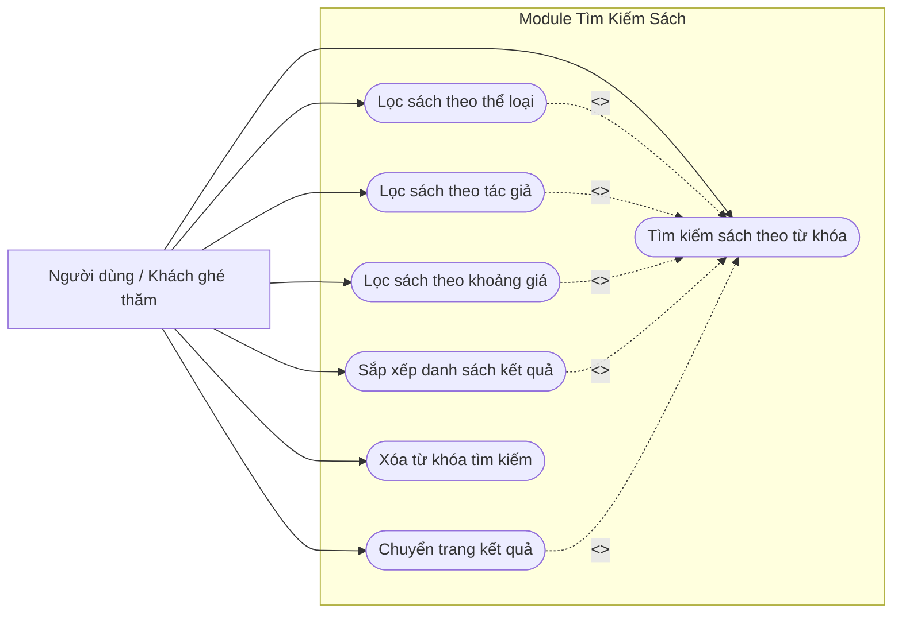
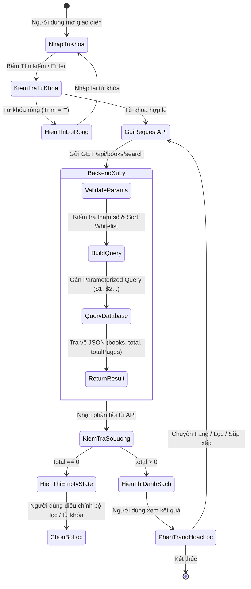
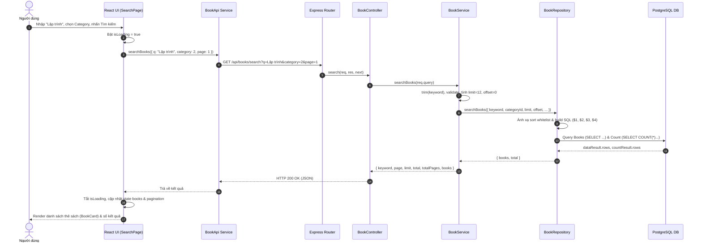
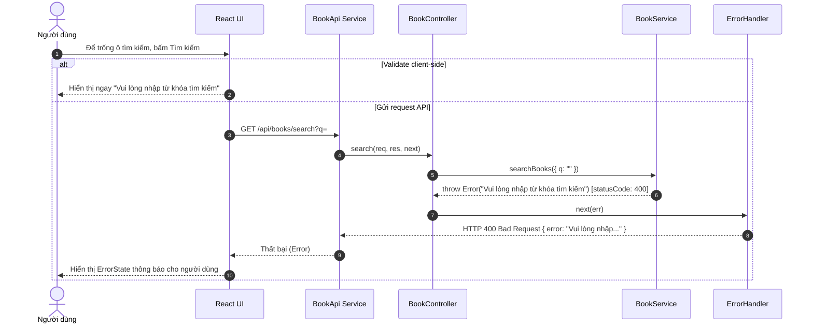
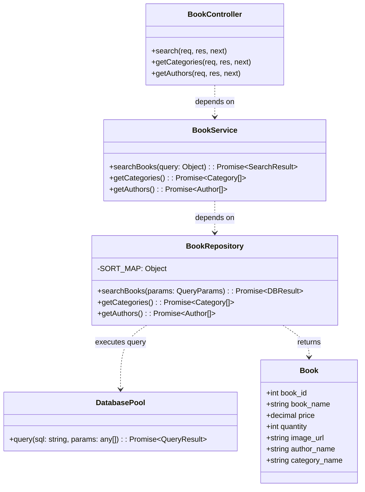
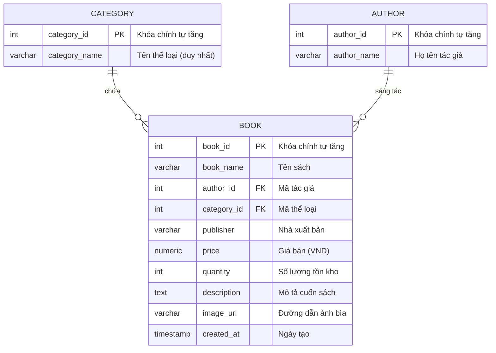

# BÁO CÁO ĐỒ ÁN MÔN CÔNG NGHỆ PHẦN MỀM

## ĐỀ TÀI: MODULE TÌM KIẾM SÁCH TRONG HỆ THỐNG CỬA HÀNG BÁN SÁCH TRỰC TUYẾN

---

## MỤC LỤC

1. [Tổng Quan Đề Tài & Phạm Vi Nghiên Cứu](#1-tổng-quan-đề-tài--phạm-vi-nghiên-cứu)
2. [Kiến Trúc & Công Nghệ Sử Dụng](#2-kiến-trúc--công-nghệ-sử-dụng)
3. [Mô Hình Ca Sử Dụng (Use Case Diagram & Specification)](#3-mô-hình-ca-sử-dụng-use-case-diagram--specification)
4. [Biểu Đồ Hoạt Động (Activity Diagram)](#4-biểu-đồ-hoạt-động-activity-diagram)
5. [Biểu Đồ Tuần Tự (Sequence Diagram)](#5-biểu-đồ-tuần-tự-sequence-diagram)
6. [Biểu Đồ Lớp (Class Diagram)](#6-biểu-đồ-lớp-class-diagram)
7. [Thiết Kế Cơ Sở Dữ Liệu (ERD & Data Dictionary)](#7-thiết-kế-cơ-sở-dữ-liệu-erd--data-dictionary)
8. [Tài Liệu Đặc Tả API (API Documentation)](#8-tài-liệu-đặc-tả-api-api-documentation)
9. [Bộ Kịch Bản Kiểm Thử (Test Cases)](#9-bộ-kịch-bản-kiểm-thử-test-cases)
10. [Báo Cáo Kết Quả Kiểm Thử (Test Report)](#10-báo-cáo-kết-quả-kiểm-thử-test-report)
11. [Kịch Bản Demo Nghiệm Thu (Demo Script)](#11-kịch-bản-demo-nghiệm-thu-demo-script)

---

## 1. TỔNG QUAN ĐỀ TÀI & PHẠM VI NGHIÊN CỨU

### 1.1. Đặt vấn đề

Trong các hệ thống thương mại điện tử chuyên ngành sách (Bookstore E-commerce), việc định vị và tìm kiếm sản phẩm nhanh chóng, chính xác là yếu tố sống còn quyết định trải nghiệm người dùng. Module tìm kiếm sách được thiết kế độc lập, tập trung giải quyết triệt để nhu cầu tra cứu sách với tốc độ cao, độ chính xác cao và an toàn bảo mật.

### 1.2. Phạm vi module (Scope)

- **Nằm trong phạm vi (In-Scope)**:
  - Nhập từ khóa tìm kiếm (tên sách, tác giả, thể loại).
  - Tìm kiếm gần đúng không phân biệt hoa thường (`ILIKE`).
  - Lọc kết quả đa tiêu chí: Thể loại (Category), Tác giả (Author), Khoảng giá (minPrice, maxPrice).
  - Sắp xếp kết quả linh hoạt: Theo giá (tăng/giảm dần), theo bảng chữ cái (A-Z, Z-A).
  - Phân trang dữ liệu (Pagination) tối ưu tải mạng và hiệu năng cơ sở dữ liệu.
  - Xử lý các trạng thái đặc biệt: Từ khóa rỗng, không có kết quả, loading, lỗi hệ thống, xóa nhanh từ khóa.
  - Bảo mật ứng dụng: Ngăn chặn tuyệt đối lỗ hổng SQL Injection bằng Parameterized Queries và Sort Whitelist.
- **Ngoại phạm vi (Out-of-Scope)**:
  - Đăng nhập/đăng ký tài khoản, phân quyền quản trị viên.
  - Quản lý giỏ hàng, đặt hàng, xử lý thanh toán.
  - Quản trị thêm/sửa/xóa sách, đánh giá bình luận, hệ thống gợi ý AI (Recommendation).

---

## 2. KIẾN TRÚC & CÔNG NGHỆ SỬ DỤNG

### 2.1. Ngăn xếp công nghệ (Technology Stack)

- **Frontend**: React 18, Vite, Vanilla CSS hiện đại (Design System, CSS Variables, Responsive Grid).
- **Backend**: Node.js, Express Framework (v5).
- **Database**: PostgreSQL (Relational Database Management System).
- **Giao thức**: HTTP RESTful API, JSON data exchange.

### 2.2. Kiến trúc phân tầng Backend (Layered Architecture)

Hệ thống tuân thủ nghiêm ngặt nguyên lý Single Responsibility Principle (SRP) và mô hình 4 tầng chuẩn công nghiệp:

1. **Route Layer (`routes/`)**: Định nghĩa endpoints, ánh xạ URL path và HTTP methods tới controller tương ứng.
2. **Controller Layer (`controllers/`)**: Tiếp nhận request, trích xuất query parameters, điều phối Service và trả về HTTP response (status code, JSON body).
3. **Service Layer (`services/`)**: Chứa Business Logic (nghiệp vụ hệ thống), validate dữ liệu đầu vào, chuẩn hóa chuỗi, tính toán số trang, limit/offset.
4. **Repository Layer (`repositories/`)**: Trực tiếp tương tác với cơ sở dữ liệu PostgreSQL qua connection pool, khởi dựng câu lệnh SQL tham số hóa (`$1, $2,...`), ánh xạ kết quả trả về.

```
[ Client / React Frontend ]
           │  HTTP Request (GET /api/books/search?q=...)
           ▼
[ Express Router (book.routes.js) ]
           │
           ▼
[ Controller (book.controller.js) ]
           │
           ▼
[ Service (book.service.js) ] ── (Validate, Calculate Pagination)
           │
           ▼
[ Repository (book.repository.js) ] ── (SQL Builder & Whitelist)
           │
           ▼
[ PostgreSQL Database (TIM_KIEM_SACH) ]
```

---

## 3. MÔ HÌNH CA SỬ DỤNG (USE CASE DIAGRAM & SPECIFICATION)

### 3.1. Sơ đồ Use Case (Mermaid)



### 3.2. Bảng đặc tả Use Case chi tiết (Use Case Specification)

| Thuộc tính                           | Chi tiết                                                                                                                                                                                                                                                                                                                                                                                             |
| :----------------------------------- | :--------------------------------------------------------------------------------------------------------------------------------------------------------------------------------------------------------------------------------------------------------------------------------------------------------------------------------------------------------------------------------------------------- |
| **Mã Use Case**                      | **UC-01**                                                                                                                                                                                                                                                                                                                                                                                            |
| **Tên Use Case**                     | Tìm kiếm sách (Search Books)                                                                                                                                                                                                                                                                                                                                                                         |
| **Tác nhân (Actor)**                 | Người dùng (Khách hàng)                                                                                                                                                                                                                                                                                                                                                                              |
| **Mục đích**                         | Cho phép người dùng tìm kiếm và lọc danh sách sách trong hệ thống theo nhiều tiêu chí.                                                                                                                                                                                                                                                                                                               |
| **Tiền điều kiện**                   | Hệ thống Web đang hoạt động, kết nối CSDL PostgreSQL ổn định.                                                                                                                                                                                                                                                                                                                                        |
| **Hậu điều kiện**                    | Danh sách sách phù hợp được hiển thị trực quan kèm thông tin phân trang.                                                                                                                                                                                                                                                                                                                             |
| **Luồng sự kiện chính (Basic Flow)** | 1. Người dùng nhập từ khóa vào ô tìm kiếm.<br>2. (Tùy chọn) Người dùng chọn thể loại, tác giả, nhập khoảng giá hoặc kiểu sắp xếp.<br>3. Người dùng nhấn nút "Tìm kiếm" hoặc nhấn phím Enter.<br>4. Hệ thống kiểm tra từ khóa hợp lệ.<br>5. Hệ thống truy vấn CSDL tìm kiếm gần đúng theo tên sách, tác giả, thể loại.<br>6. Hệ thống hiển thị danh sách sách thỏa mãn cùng tổng số kết quả tìm thấy. |
| **Luồng phụ (Alternative Flows)**    | **A1: Người dùng chuyển trang (Pagination)**<br>- Người dùng chọn số trang mong muốn.<br>- Hệ thống tải các bản ghi tiếp theo tương ứng với offset.<br>**A2: Người dùng xóa từ khóa**<br>- Người dùng bấm nút ✕ trên thanh tìm kiếm.<br>- Ô nhập liệu được xóa trống.                                                                                                                                |
| **Luồng ngoại lệ (Exception Flows)** | **E1: Từ khóa rỗng**<br>- Nếu người dùng không nhập hoặc chỉ nhập dấu cách trắng rồi tìm kiếm:<br>- Hệ thống hiển thị thông báo lỗi: _"Vui lòng nhập từ khóa tìm kiếm"_ (HTTP 400).<br>**E2: Không tìm thấy kết quả**<br>- Không có sách nào khớp với từ khóa và bộ lọc.<br>- Hệ thống hiển thị Empty State kèm gợi ý tìm kiếm thay thế.                                                             |

---

## 4. BIỂU ĐỒ HOẠT ĐỘNG (ACTIVITY DIAGRAM)



---

## 5. BIỂU ĐỒ TUẦN TỰ (SEQUENCE DIAGRAM)

### 5.1. Luồng tìm kiếm thành công (Success Flow)



### 5.2. Luồng xử lý từ khóa rỗng (Validation Exception Flow)



---

## 6. BIỂU ĐỒ LỚP (CLASS DIAGRAM)



---

## 7. THIẾT KẾ CƠ SỞ DỮ LIỆU (ERD & DATA DICTIONARY)

### 7.1. Sơ đồ thực thể kết hợp (ERD - Mermaid)



### 7.2. Từ điển dữ liệu (Data Dictionary)

#### Bảng `category` (Thể loại sách)

| Tên cột         | Kiểu dữ liệu | Ràng buộc        | Mô tả                               |
| :-------------- | :----------- | :--------------- | :---------------------------------- |
| `category_id`   | SERIAL       | PRIMARY KEY      | Định danh duy nhất thể loại         |
| `category_name` | VARCHAR(100) | NOT NULL, UNIQUE | Tên thể loại (VD: CNTT, Văn học...) |

#### Bảng `author` (Tác giả)

| Tên cột       | Kiểu dữ liệu | Ràng buộc   | Mô tả                      |
| :------------ | :----------- | :---------- | :------------------------- |
| `author_id`   | SERIAL       | PRIMARY KEY | Định danh duy nhất tác giả |
| `author_name` | VARCHAR(150) | NOT NULL    | Họ tên tác giả             |

#### Bảng `book` (Sách)

| Tên cột       | Kiểu dữ liệu  | Ràng buộc                            | Mô tả                       |
| :------------ | :------------ | :----------------------------------- | :-------------------------- |
| `book_id`     | SERIAL        | PRIMARY KEY                          | Định danh duy nhất sách     |
| `book_name`   | VARCHAR(255)  | NOT NULL                             | Tên tác phẩm sách           |
| `author_id`   | INT           | FOREIGN KEY (`author.author_id`)     | Tác giả viết sách           |
| `category_id` | INT           | FOREIGN KEY (`category.category_id`) | Thể loại sách               |
| `price`       | NUMERIC(12,2) | NOT NULL, CHECK(price >= 0)          | Đơn giá bán                 |
| `quantity`    | INT           | DEFAULT 0, CHECK(quantity >= 0)      | Số lượng sách còn trong kho |
| `image_url`   | VARCHAR(500)  | NULLABLE                             | URL ảnh bìa sách            |
| `description` | TEXT          | NULLABLE                             | Giới thiệu nội dung sách    |
| `created_at`  | TIMESTAMP     | DEFAULT CURRENT_TIMESTAMP            | Thời điểm thêm vào hệ thống |

---

## 8. TÀI LIỆU ĐẶC TẢ API (API DOCUMENTATION)

### 8.1. API: Tìm kiếm sách

- **Endpoint**: `GET /api/books/search`
- **Mô tả**: Tìm kiếm sách đa tiêu chí (keyword, category, author, price range, sort, pagination).
- **Query Parameters**:
  | Tham số | Kiểu | Bắt buộc | Mặc định | Ý nghĩa |
  | :--- | :--- | :--- | :--- | :--- |
  | `q` | String | **Có** | - | Từ khóa cần tìm (so sánh với tên sách, tác giả, thể loại) |
  | `category` | Integer | Không | - | Lọc chính xác theo `category_id` |
  | `author` | Integer | Không | - | Lọc chính xác theo `author_id` |
  | `minPrice` | Float | Không | - | Lọc đơn giá sách >= `minPrice` |
  | `maxPrice` | Float | Không | - | Lọc đơn giá sách <= `maxPrice` |
  | `sort` | String | Không | `name_asc` | Tiêu chí sắp xếp: `name_asc`, `name_desc`, `price_asc`, `price_desc` |
  | `page` | Integer | Không | 1 | Số trang hiện tại (tối thiểu 1) |
  | `limit` | Integer | Không | 12 | Số bản ghi trên 1 trang (tối đa 50) |

- **HTTP Status Codes**:
  - `200 OK`: Truy vấn thành công.
  - `400 Bad Request`: Thiếu từ khóa `q` hoặc từ khóa chỉ chứa khoảng trắng.
  - `500 Internal Server Error`: Lỗi máy chủ hoặc CSDL.

- **Sample Request**:

  ```http
  GET /api/books/search?q=Lập%20trình&category=2&sort=price_asc&page=1&limit=6 HTTP/1.1
  Host: localhost:5000
  ```

- **Sample Response (200 OK)**:
  ```json
  {
    "keyword": "Lập trình",
    "page": 1,
    "limit": 6,
    "total": 3,
    "totalPages": 1,
    "books": [
      {
        "book_id": 1,
        "book_name": "Lập trình C căn bản",
        "price": "120000.00",
        "quantity": 50,
        "image_url": "https://example.com/img1.jpg",
        "author_name": "Robert C. Martin",
        "category_name": "Công nghệ thông tin"
      },
      {
        "book_id": 2,
        "book_name": "Lập trình PHP nâng cao",
        "price": "150000.00",
        "quantity": 30,
        "image_url": "https://example.com/img2.jpg",
        "author_name": "Robert C. Martin",
        "category_name": "Công nghệ thông tin"
      },
      {
        "book_id": 3,
        "book_name": "Lập trình Web với JavaScript",
        "price": "180000.00",
        "quantity": 20,
        "image_url": "https://example.com/img3.jpg",
        "author_name": "Kyle Simpson",
        "category_name": "Công nghệ thông tin"
      }
    ]
  }
  ```

### 8.2. API: Lấy danh sách Thể loại (Categories)

- **Endpoint**: `GET /api/books/categories`
- **Response**: Mảng đối tượng thể loại sắp xếp theo tên:
  ```json
  [
    { "category_id": 2, "category_name": "Công nghệ thông tin" },
    { "category_id": 3, "category_name": "Kỹ năng sống" },
    { "category_id": 4, "category_name": "Thiếu nhi" },
    { "category_id": 1, "category_name": "Văn học" }
  ]
  ```

### 8.3. API: Lấy danh sách Tác giả (Authors)

- **Endpoint**: `GET /api/books/authors`
- **Response**: Mảng đối tượng tác giả sắp xếp theo tên:
  ```json
  [
    { "author_id": 3, "author_name": "Dale Carnegie" },
    { "author_id": 5, "author_name": "Kyle Simpson" },
    { "author_id": 1, "author_name": "Nguyễn Nhật Ánh" },
    { "author_id": 2, "author_name": "Robert C. Martin" },
    { "author_id": 4, "author_name": "Tô Hoài" }
  ]
  ```

---

## 9. BỘ KỊCH BẢN KIỂM THỬ (TEST CASES)

| Mã TC     | Tiêu đề Test Case                   | Dữ liệu đầu vào (Input)                          | Kết quả kỳ vọng (Expected Output)                                                                | Loại kiểm thử          |
| :-------- | :---------------------------------- | :----------------------------------------------- | :----------------------------------------------------------------------------------------------- | :--------------------- |
| **TC-01** | Tìm kiếm từ khóa hợp lệ             | `q=Lập trình`                                    | Trả về HTTP 200, danh sách chứa các sách có tên/tác giả/thể loại chứa "Lập trình" (`total = 3`). | Chức năng (Bắt buộc)   |
| **TC-02** | Tìm kiếm không phân biệt hoa thường | `q=lẬp tRìNh`                                    | Trả về HTTP 200, kết quả giống hệt `q=Lập trình` nhờ `ILIKE`.                                    | Chức năng (Bắt buộc)   |
| **TC-03** | Tìm kiếm với từ khóa rỗng           | `q=` hoặc `q=   `                                | Trả về HTTP 400 Bad Request, message: _"Vui lòng nhập từ khóa tìm kiếm"_.                        | Ngoại lệ (Bắt buộc)    |
| **TC-04** | Tìm kiếm không có kết quả           | `q=xyz123khongton`                               | Trả về HTTP 200, `books: []`, `total: 0`, `totalPages: 0`.                                       | Ngoại lệ (Bắt buộc)    |
| **TC-05** | Chống tấn công SQL Injection        | `q=' OR '1'='1`                                  | Trả về HTTP 200, `total: 0`, không crash server, không lộ dữ liệu toàn DB.                       | Bảo mật (Bắt buộc)     |
| **TC-06** | Lọc theo Thể loại                   | `q=Lập trình&category=2`                         | Chỉ trả về sách thuộc danh mục có ID = 2 ("Công nghệ thông tin").                                | Mở rộng                |
| **TC-07** | Lọc theo Tác giả                    | `q=Lập trình&author=2`                           | Chỉ trả về 2 cuốn của tác giả "Robert C. Martin".                                                | Mở rộng                |
| **TC-08** | Lọc theo Khoảng giá                 | `q=Lập trình&minPrice=130000&maxPrice=160000`    | Chỉ trả về sách có giá từ 130,000đ đến 160,000đ ("Lập trình PHP nâng cao").                      | Mở rộng                |
| **TC-09** | Sắp xếp giá tăng dần                | `q=Lập trình&sort=price_asc`                     | Danh sách sách theo thứ tự giá: 120.000đ -> 150.000đ -> 180.000đ.                                | Mở rộng                |
| **TC-10** | Sắp xếp giá giảm dần                | `q=Lập trình&sort=price_desc`                    | Danh sách sách theo thứ tự giá: 180.000đ -> 150.000đ -> 120.000đ.                                | Mở rộng                |
| **TC-11** | Sắp xếp tên Z-A                     | `q=Lập trình&sort=name_desc`                     | Sách sắp xếp thứ tự bảng chữ cái ngược: W -> P -> C.                                             | Mở rộng                |
| **TC-12** | Phân trang hợp lệ                   | `q=Lập trình&page=1&limit=2` và `page=2&limit=2` | Trang 1 trả về 2 cuốn đầu tiên, Trang 2 trả về 1 cuốn cuối (`totalPages = 2`).                   | Hiệu năng / Phân trang |

---

## 10. BÁO CÁO KẾT QUẢ KIỂM THỬ (TEST REPORT)

- **Môi trường thử nghiệm**:
  - Hệ điều hành: Windows 11
  - Node.js runtime: v24.21.0
  - CSDL: PostgreSQL 16
  - Trình duyệt: Google Chrome / Edge
  - Backend Port: 5000
  - Frontend Port: 3000

- **Tổng hợp kết quả**:
  - Tổng số Test Cases: **12**
  - Số Test Cases Đạt (Pass): **12 / 12 (100%)**
  - Số Test Cases Lỗi (Fail): **0**
  - Đánh giá bảo mật: Đạt tiêu chuẩn OWASP Top 10 về phòng chống SQL Injection nhờ Parameterized Queries & Whitelist.

---

## 11. KỊCH BẢN DEMO NGHIỆM THU (DEMO SCRIPT)

Khi thuyết trình hoặc nghiệm thu đồ án trước Hội đồng / Giảng viên, thực hiện tuần tự theo kịch bản 6 bước sau:

1. **Bước 1 - Giới thiệu giao diện ban đầu**:
   - Mở trình duyệt tại `http://localhost:3000`.
   - Giới thiệu thanh tìm kiếm, các bộ lọc thể loại, tác giả, khoảng giá, sắp xếp và card hướng dẫn người dùng.
2. **Bước 2 - Demo tìm kiếm cơ bản & tìm gần đúng**:
   - Nhập từ khóa: `lập trình` (chữ thường, có dấu).
   - Nhấn **Tìm kiếm** hoặc phím **Enter**.
   - Quan sát kết quả: Tìm thấy 3 cuốn sách công nghệ thông tin.
3. **Bước 3 - Demo tính năng Xóa nhanh & Validate từ khóa rỗng**:
   - Nhấn nút **✕** trên ô tìm kiếm để xóa trắng từ khóa.
   - Nhấn nút **Tìm kiếm** khi ô đang trống.
   - Quan sát thông báo lỗi: _"Vui lòng nhập từ khóa tìm kiếm"_.
4. **Bước 4 - Demo bộ lọc nâng cao (Category, Author, Price)**:
   - Nhập lại từ khóa: `Lập trình`.
   - Chọn tác giả: **Robert C. Martin**.
   - Bấm **Áp dụng** -> Danh sách chỉ còn 2 cuốn.
   - Nhập khoảng giá từ `130000` đến `160000` -> Chỉ còn 1 cuốn _"Lập trình PHP nâng cao"_.
5. **Bước 5 - Demo sắp xếp và phân trang**:
   - Nhấn nút **Đặt lại** bộ lọc.
   - Chọn sắp xếp: **Giá giảm dần** -> Cuốn 180.000đ nhảy lên đầu tiên.
   - Thử nghiệm tìm từ khóa bao quát để chuyển qua lại giữa các trang.
6. **Bước 6 - Demo xử lý không tìm thấy và An toàn bảo mật (SQL Injection)**:
   - Thử nghiệm từ khóa không tồn tại: `sach_khong_co_123` -> Hiển thị Empty State thân thiện kèm gợi ý.
   - Thử nghiệm tấn công SQL Injection: `' OR '1'='1` -> Hệ thống an toàn tuyệt đối, trả về 0 kết quả, không sập server.
